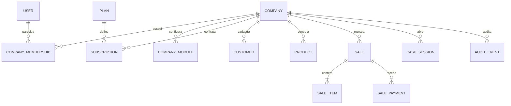

# Modelo de dados inicial — RMC Flow Comércio Cloud

## Decisão de arquitetura

Usar inicialmente um banco MySQL exclusivo do produto, `rona7916_rmc_flow_comercio_cloud`, compartilhado entre as empresas assinantes. O isolamento é lógico por empresa (`company_id`) e precisa ser garantido no servidor em todas as consultas, gravações, downloads, exportações e relatórios. O navegador nunca escolhe livremente o escopo da empresa ativa.

Este documento define o modelo conceitual; nomes finais, tipos, índices e migrations serão definidos ao escolher a estrutura da aplicação e conferir a versão MySQL efetivamente disponível.

## Identidade e isolamento

### `companies`

Uma linha por empresa cliente: nome legal/fantasia, documento, contatos, endereço, timezone, status operacional, datas de criação e atualização.

### `users`

Identidade de login: nome, e-mail normalizado e único no produto, hash de senha, status, timestamps de verificação e último acesso. Segredos de autenticação nunca são armazenados em texto puro.

### `company_memberships`

Vínculo de usuário à empresa: `company_id`, `user_id`, papel, status e preferências. Índice único `(company_id, user_id)`. Essa separação permite que um usuário autorizado acesse mais de uma empresa, sem compartilhar os dados operacionais entre elas.

### `roles` / `permissions` ou enumeração inicial

Papéis iniciais para paridade: Administrador, Atendente e Mecânico. A autorização deve ser validada no backend; esconder um item do menu não é controle de acesso. Restrições específicas serão mapeadas por ação/módulo antes de concluir a implementação.

### Contexto confiável da empresa

Após login, o servidor resolve a empresa e membership autorizados e estabelece o contexto ativo na sessão. Toda operação valida membership e aplica `company_id` no escopo do banco. Rotas com identificadores de registros devem validar simultaneamente o ID e o `company_id`. Índices únicos de negócio devem incluir `company_id` (por exemplo, SKU/código interno), permitindo que empresas diferentes usem os mesmos códigos.

## Configuração, módulos e assinatura

### `company_settings`

Configurações por empresa, como atividade principal, preferências de interface, moeda e dados usados nos documentos. Configuração de módulos deve ter estrutura tipada, não depender de valores livres sem validação.

### `company_modules`

Uma linha por módulo e empresa: módulo (`services` inicialmente), habilitado/desabilitado, origem da habilitação (padrão/plano/admin), autor e timestamps. Verificar módulo tanto ao renderizar menus quanto em toda rota/ação do backend. Desabilitar o módulo oculta o acesso, preservando os registros históricos.

### `plans`

Catálogo de planos próprios do Comércio Cloud: código, nome, ciclo anual, valor inicial em centavos e valor de renovação em centavos, limites e recursos, status comercial. Regra comercial definida: R$ 179,00 no primeiro ciclo (R$ 99,00 pelo sistema + R$ 80,00 pela hospedagem) e R$ 80,00 nas renovações anuais. A modalidade de cobrança e limites do plano ainda serão definidos; não copiar planos do Oficina Cloud.

### `subscriptions`

Assinatura da empresa: `company_id`, `plan_id`, status, início, fim do período pago, cancelamento, política aplicada, IDs de referência do Mercado Pago e produto no painel central. O registro de assinatura pertence ao Comércio Cloud e não é compartilhado com dados de Oficina.

### `payment_events`

Eventos recebidos do Mercado Pago: ID externo único, tipo, referência de assinatura, etapa (`initial` ou `renewal`), valor esperado e pago em centavos, estado, recebido/processado em, resultado e metadados mínimos necessários. Registrar também estado, data, tentativas e erro da sincronização ao painel central para permitir reenvio sem reaplicar o pagamento. Usar unicidade do identificador externo para idempotência. Validar a notificação consultando a API do provedor antes de alterar acesso; não confiar apenas no conteúdo recebido pelo webhook.

### Fronteira com painel Mercado Pago/assinaturas existente

Reutilizar a integração/painel somente através da interface autenticada já existente, após conferir seu contrato. Criar identificador de produto e planos próprios do Comércio Cloud, separando callbacks/eventos, registros, preços e estados. O webhook atual do Oficina Cloud serve como referência; não alterar suas regras ou o banco Oficina ao desenvolver este produto.

## Entidades operacionais

Todas as tabelas abaixo recebem `company_id` obrigatório, índice que inicia por `company_id` nos acessos comuns e chaves estrangeiras compatíveis com o escopo da empresa:

- `customers`, `suppliers`, `debtors`.
- `product_categories`, `products` e `services` (serviços condicionado ao módulo).
- `stock_movements`.
- `sales`, `sale_items`, `sale_payments`.
- `cash_sessions`, `cash_movements`.
- `financial_categories`, `accounts_payable`, `accounts_receivable`, `financial_payments`.
- `purchases`, `purchase_items`, `purchase_installments`.
- Opcional: `assets`/`vehicles`, `appointments`, `quotes`, `quote_items`, `service_orders`, `service_order_items`, `warranties`.
- `audit_events`, com empresa, usuário, ação, entidade, referência, data/hora e metadados minimizados.
- `exports`/`backups`, com empresa, solicitante, estado, expiração e localização privada do artefato.

Valores monetários: armazenar como decimal exato ou centavos inteiros; nunca ponto flutuante binário. Estoque, pagamentos e estornos precisam ser gravados em transações para evitar estados parciais. Registros pagos não são apagados: cancelamentos e estornos mantêm histórico e referência à operação de origem.

## Relações conceituais

Todas as entidades operacionais ligadas por chaves estrangeiras devem pertencer ao mesmo `company_id`; isso será validado por constraints/serviços de domínio e regras de consulta.

## Fluxos principais

1. **Cadastro:** criar usuário e empresa, criar membership de Administrador e aplicar módulos padrão.
2. **Contratação:** iniciar checkout anual Mercado Pago com produto/plano Comércio Cloud; manter acesso pendente até confirmação válida.
3. **Confirmação:** webhook deduplicado verifica o pagamento no provedor, registra evento e atualiza período/status da assinatura; persistir mudanças de forma atômica.
4. **Acesso:** middleware avalia sessão, membership, permissões, módulo habilitado e estado da assinatura segundo política comercial que ainda será definida.
5. **Operação:** cada fluxo grava transação comercial/financeira e trilha de auditoria, mantendo consistência entre itens, estoque, caixa e financeiro.
6. **Desativação de serviço:** retirar menus e negar novas operações do módulo; manter dados históricos disponíveis apenas conforme papel e política definidos.

## Decisões ainda pendentes antes de schema físico

- Convenções finais de deploy e migrations após a validação do ambiente compartilhado.
- Se login/e-mail será único globalmente ou por empresa; modelo proposto usa login global com memberships.
- Limites de usuários e papéis por plano.
- Limites por plano, teste, tolerância, modalidade de renovação e política de suspensão/exportação. Preços iniciais e de renovação definidos na especificação.
- Quais limites/recursos do módulo de serviços entram em cada plano.
- Compatibilidade exata da versão do MySQL no banco destinado ao Comércio Cloud.
- Contrato técnico de API com o painel central: autenticação, produto, IDs e eventos.

## Próxima entrega

Após resolver as escolhas acima que impactam schema, definir migrations físicas e iniciar a fundação de autenticação, empresa/membership, configuração de módulos e isolamento por tenant. Não criar tabelas em produção nesta etapa.

